# GitHub para trabalhos em grupo

Guia rápido para usar o **GitHub Desktop** com o **Eclipse** nos trabalhos da disciplina.

A ideia é simples: o grupo inteiro trabalha no mesmo repositório, na branch `main`, e cada um cuida dos seus próprios arquivos (suas classes). Cada envio fica registrado com o nome de quem fez, então dá para ver o que cada integrante fez.

---

## Sumário

1. [Vocabulário](#1-vocabulário)
2. [Preparando o computador (uma vez só)](#2-preparando-o-computador-uma-vez-só)
3. [Criando o repositório do grupo](#3-criando-o-repositório-do-grupo)
4. [Ligando o projeto do Eclipse](#4-ligando-o-projeto-do-eclipse)
5. [A rotina: pull, commit, push](#5-a-rotina-pull-commit-push)
6. [Aviso "Newer commits on remote"](#6-aviso-newer-commits-on-remote)
7. [Vendo o que cada integrante fez](#7-vendo-o-que-cada-integrante-fez)
8. [Regras do grupo](#8-regras-do-grupo)

---

## 1. Vocabulário

| Termo | O que é |
|---|---|
| **Repositório** | A pasta do trabalho, guardada no GitHub, com todo o histórico. |
| **Commit** | Um "salvar" com descrição: o que mudou, quem fez e quando. |
| **Push** | Envia os seus commits para o GitHub. |
| **Pull** | Traz para o seu computador o que os colegas enviaram. |
| **Fetch** | Só verifica se tem algo novo no GitHub, sem baixar ainda. |

> Você programa no **Eclipse**. O **GitHub Desktop** salva no histórico e envia, com botões.

---

## 2. Preparando o computador (uma vez só)

1. Crie uma conta em [github.com](https://github.com).
2. Instale o GitHub Desktop: [desktop.github.com](https://desktop.github.com). Ele já vem com o Git, não precisa instalar mais nada.
3. Abra o GitHub Desktop e entre com a sua conta em **File → Options → Accounts → Sign in**.

<!-- PRINT 01: GitHub Desktop > File > Options > aba Accounts, já com a conta logada (foto e nome de usuário aparecendo). -->
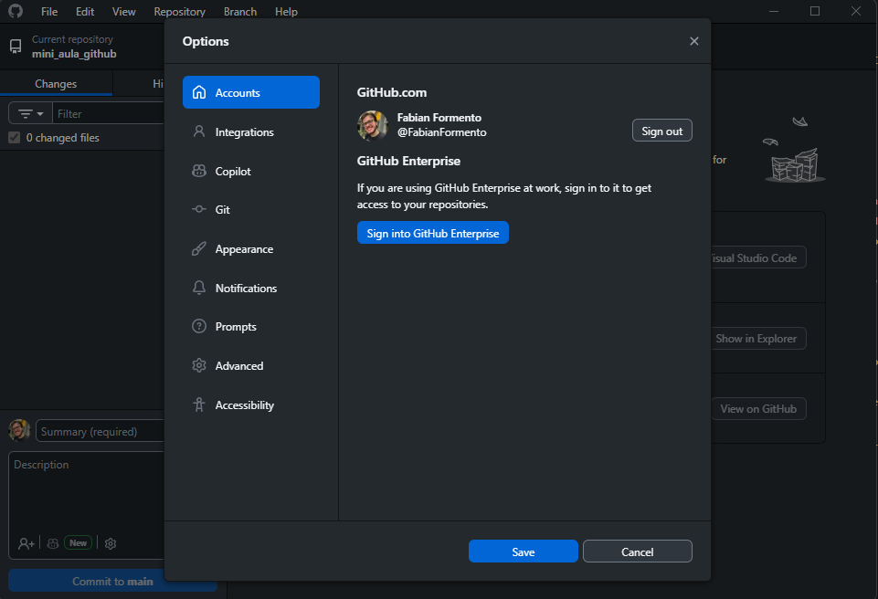

4. Em **File → Options → Git**, confira o nome e o e-mail.

<!-- PRINT 02: GitHub Desktop > File > Options > aba Git, mostrando os campos Name e Email preenchidos. -->
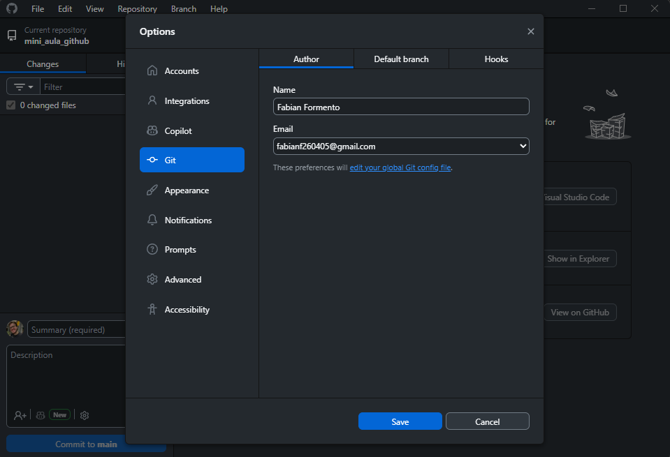

> ⚠️ **Importante:** use o **mesmo e-mail da sua conta GitHub**. Se o e-mail for outro, os seus commits não aparecem no seu nome.

> No Mac, o caminho é **GitHub Desktop → Settings** em vez de **File → Options**.

---

## 3. Criando o repositório do grupo

**Só um integrante faz os passos 1 e 2.**

1. No site do GitHub, clique em **+ → New repository**:

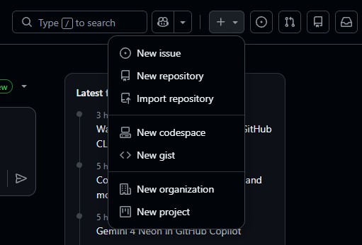

   Na tela de criação:
   - Dê um nome (ex.: `trabalho-grupo`);
   - Marque **Add a README file**;
   - Em **Add .gitignore**, escolha **Java** (isso evita enviar os arquivos `.class` compilados).

<!-- PRINT 03 (site): tela "Create a new repository" do github.com, com o nome preenchido, "Add a README file" marcado e .gitignore = Java. -->
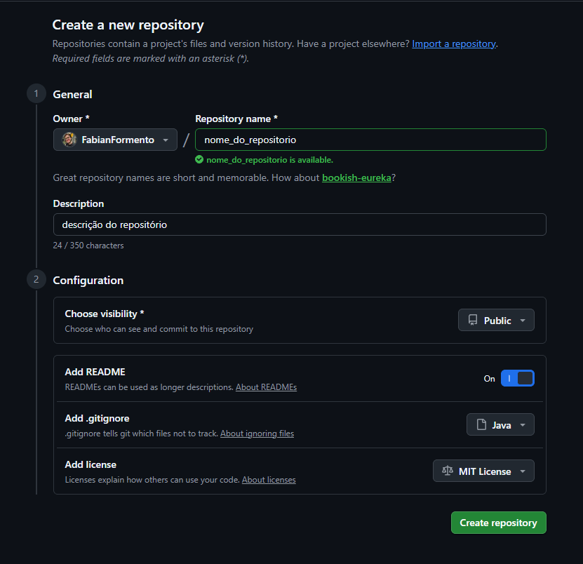

2. Convide os colegas em **Settings → Collaborators → Add people**.

<!-- PRINT 04 (site): Settings > Collaborators do repositório, com o botão "Add people" e pelo menos um convite pendente. -->
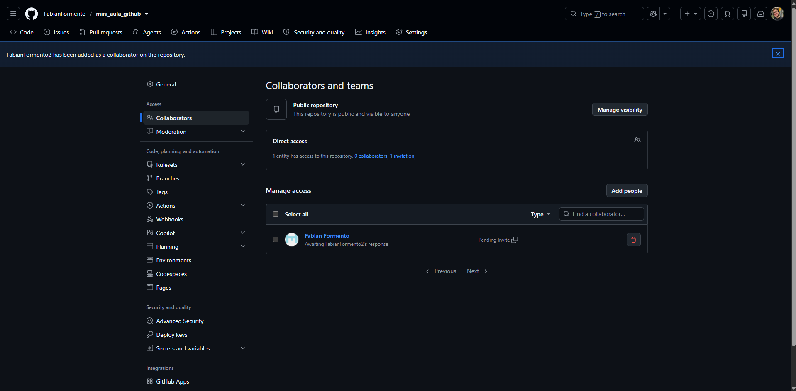

**Todos os integrantes:**

3. Aceite o convite (chega por e-mail e aparece em github.com).
4. No GitHub Desktop, vá em **File → Clone repository**, escolha o repositório na aba **GitHub.com** e clique em **Clone**.

<!-- PRINT 05: janela "Clone a repository" do GitHub Desktop, aba GitHub.com, com o repositório selecionado na lista e o campo Local path visível. -->
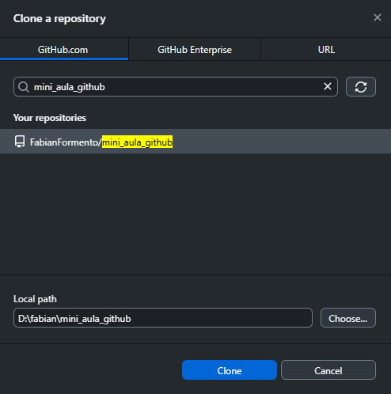

> Anote o **Local path**: é a pasta do trabalho no seu computador (por padrão `Documentos\GitHub\nome-do-repositorio`). O Eclipse vai usar essa pasta.

---

## 4. Ligando o projeto do Eclipse

O projeto Java precisa ficar **dentro da pasta do repositório**. Se ficar fora, o GitHub Desktop não enxerga as mudanças.

### Quem criou o repositório

1. No Eclipse: **File → New → Java Project**.
2. Desmarque **Use default location** e, em **Location**, escolha a pasta clonada.
3. Desmarque **Create module-info.java file**.
4. Clique em **Finish**.

<!-- PRINT 06 (Eclipse): tela "New Java Project" com "Use default location" desmarcado e o Location apontando para a pasta do repositório. -->
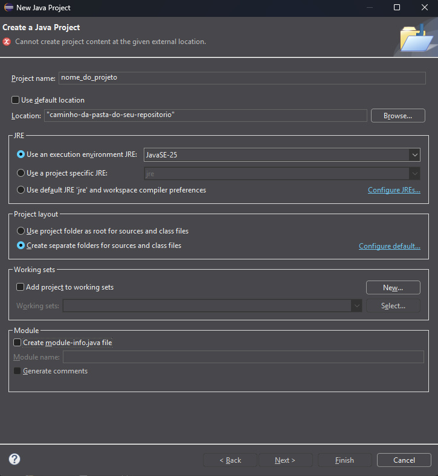

5. No GitHub Desktop, faça o commit e o push do projeto (veja a [rotina](#5-a-rotina-pull-commit-push)), com o Summary `Cria projeto Java`.

### Os outros integrantes

1. No GitHub Desktop, clique em **Fetch origin** e depois em **Pull origin**.
2. No Eclipse: **File → Import → General → Existing Projects into Workspace**.
3. Em **Select root directory**, escolha a pasta clonada.
4. **Não** marque **Copy projects into workspace**.
5. Clique em **Finish**.

<!-- PRINT 07 (Eclipse): tela "Import Projects" com a pasta do repositório em "Select root directory", o projeto marcado e "Copy projects into workspace" DESMARCADO. -->
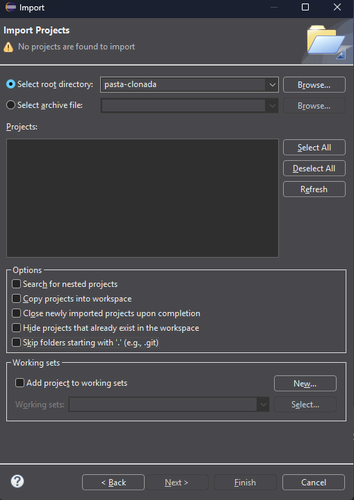

---

## 5. A rotina: pull, commit, push

Faça isso **toda vez** que for trabalhar no projeto:

```
Fetch / Pull origin  →  F5 no Eclipse  →  programar  →  Commit to main  →  Push origin
```

> Nos prints abaixo a branch aparece como `teste`. No repositório do grupo ela será a `main`, e o botão vai mostrar **Commit to main**.

### 1. Pegar o que os colegas enviaram (Pull)

Antes de começar, clique em **Fetch origin**. Se tiver algo novo, o botão vira **Pull origin**: clique nele.

<!-- PRINT 08: barra superior do GitHub Desktop com o botão "Fetch origin". -->
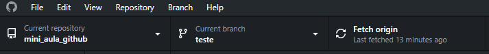

<!-- PRINT 09: o mesmo botão mostrando "Pull origin" com o número de commits para baixar (seta para baixo). -->
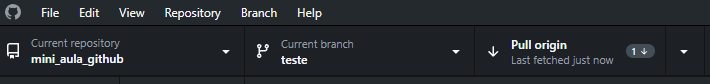

> Às vezes, depois do pull, aparece no histórico um commit chamado **"Merge branch ..."**. É normal: é o Git registrando que juntou o seu trabalho com o dos colegas.

### 2. Atualizar o Eclipse

No Eclipse, clique no projeto e aperte **F5** (Refresh). Sem isso, os arquivos que vieram no pull não aparecem no Package Explorer.

### 3. Programar a sua parte

Trabalhe normalmente no Eclipse e salve com **Ctrl+S**.

### 4. Salvar no histórico (Commit)

No GitHub Desktop, a aba **Changes** mostra os arquivos que você alterou. À direita aparecem as linhas adicionadas (verde) e removidas (vermelho).

<!-- PRINT 10: aba Changes do GitHub Desktop com um ou dois arquivos .java marcados na lista e o diff (linhas verdes) aparecendo à direita. -->
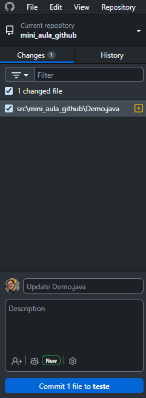

1. Deixe marcados os arquivos que vão entrar no commit.
2. No campo **Summary** (canto inferior esquerdo), escreva o que você fez.
3. Clique em **Commit to main**.

<!-- PRINT 11: canto inferior esquerdo do GitHub Desktop, com o Summary preenchido (ex.: "Adiciona classe Cliente com cadastro") e o botão "Commit to main". -->
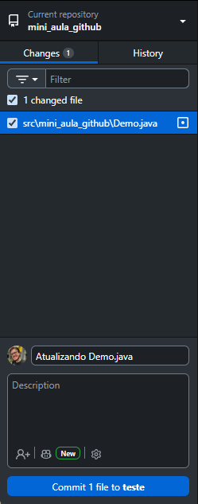

**Escrevendo um bom Summary:**

| ✅ Bom | ❌ Ruim |
|---|---|
| Adiciona classe Cliente com cadastro | ajustes |
| Corrige cálculo do total no Pedido | asdf |
| Remove método duplicado em Produto | agora vai |

O Summary é o que o grupo vai ler para entender o que você fez.

### 5. Enviar para o GitHub (Push)

Depois do commit, o botão da barra superior vira **Push origin**. Clique nele.

<!-- PRINT 12: barra superior do GitHub Desktop com o botão "Push origin" e o número de commits para enviar (seta para cima). -->
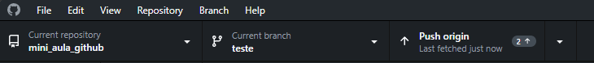

Pronto: o seu commit está no GitHub.

---

## 6. Aviso "Newer commits on remote"

Se aparecer este aviso ao clicar em **Push origin**, um colega enviou algo antes de você.

<!-- PRINT 13: janela de aviso "Newer commits on remote" do GitHub Desktop. Para provocar: no site, crie um arquivo novo (Add file > Create new file, ex.: src/Colega.java); depois altere o Demo.java no Eclipse, faça o commit e tente dar Push origin sem fazer Pull antes. -->
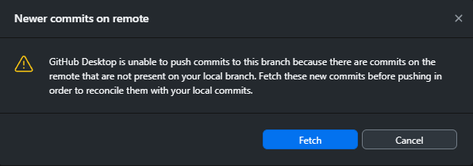

**Solução:** clique em **Fetch**, depois em **Pull origin** e, por fim, em **Push origin** de novo.

Como cada um mexe nos seus próprios arquivos, o pull junta tudo sozinho.

---

## 7. Vendo o que cada integrante fez

**No GitHub Desktop:** a aba **History** mostra todos os commits, com autor, data e as alterações.

<!-- PRINT 14: aba History do GitHub Desktop com commits de pessoas diferentes na lista e um deles selecionado. -->
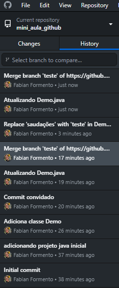

**No site do GitHub:**

- **Commits:** na página do repositório, clique em **commits** para ver a lista completa.
- **Insights → Contributors:** gráfico de contribuições de cada integrante.
- **History de um arquivo:** abra o arquivo e clique em **History** para ver quem alterou aquele arquivo.

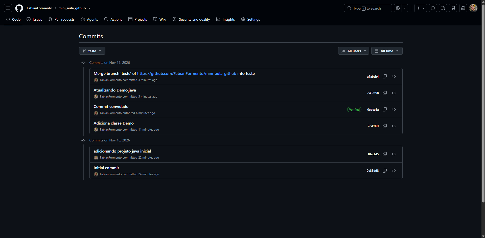

---

## 8. Regras do grupo

1. **Sempre faça Pull antes de começar.**
2. **Cada um mexe nas suas próprias classes.** Combinem quem cuida de cada arquivo.
3. **Commits frequentes, com Summary claro.**
4. **Não crie o projeto fora da pasta do repositório.**
